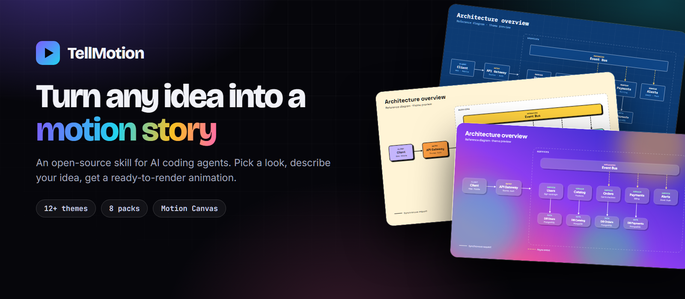
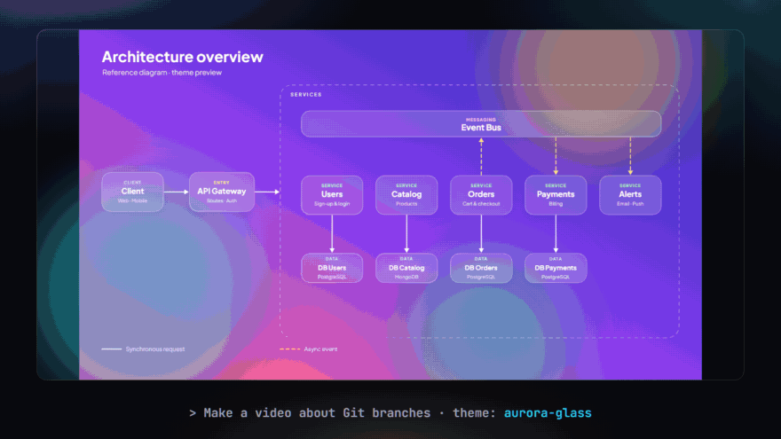
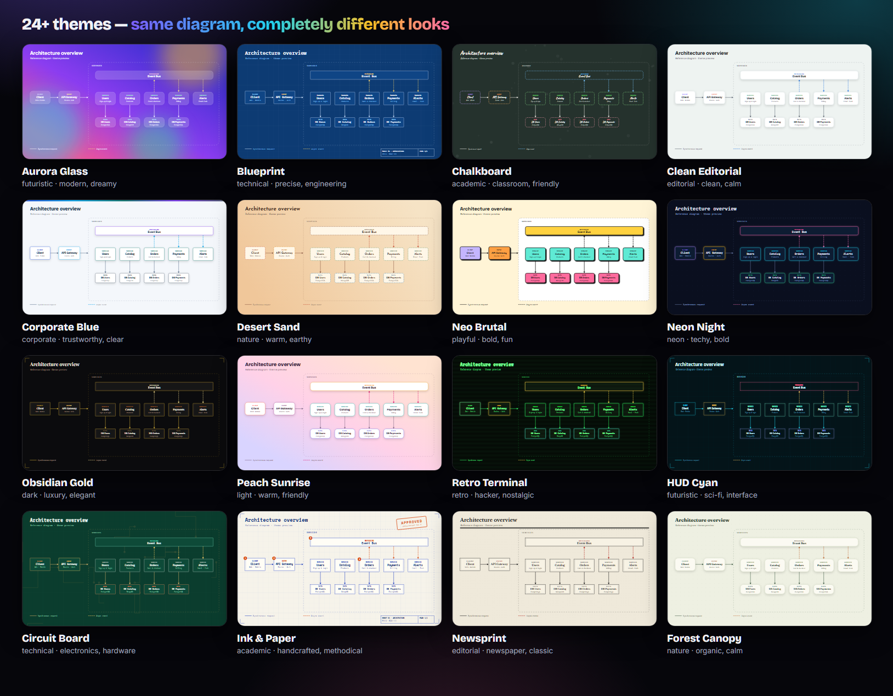

<div align="center">



<br>

**An open-source skill for AI coding agents that turns an idea into a polished 2D explainer animation.**<br>
Pick a look from a growing theme catalog, describe what you want to explain, get a ready-to-render [Motion Canvas](https://motioncanvas.io) project.

<br>

[](LICENSE)
[](LICENSE-CONTENT.md)
[](skills/tellmotion/themes)
[](skills/tellmotion/references/packs.md)
[](CONTRIBUTING.md)

[**Website**](https://yoelruso.github.io/TellMotion/) · [**Theme gallery**](https://yoelruso.github.io/TellMotion/#themes) · [**Install**](#-install-in-2-minutes) · [**Contribute a theme**](CONTRIBUTING.md) · [Español](README_ES.md)

<br>



<sub>One diagram, restyled by switching a single theme file.</sub>

</div>

<br>

## ✨ Why TellMotion

| 🎨 **Look first, code later** | 🧩 **Built for any topic** | ⚡ **One conversation** |
|---|---|---|
| Choose a ready-made theme, ask for three custom proposals, or bring your own brand. Previews are generated without Figma. | Eleven component packs — cloud, algorithms, charts, flowcharts, timelines, code, typography, science, math, UI and maps. | Brief, design, animation and review in one flow. You keep control of the story; the skill handles the boilerplate. |

## 🎬 How it works

| | Step | What happens |
|:-:|---|---|
| **1** | **Describe it** | Tell your agent what to explain. It only asks what is missing: topic, length, pace. |
| **2** | **Pick a look** | A template from the catalog, three custom proposals, or your own brand colors. |
| **3** | **Approve the storyboard** | A page with every scene, its text and its length. Changing a line here costs nothing; nothing is animated until you agree. |
| **4** | **It animates** | A Motion Canvas project is scaffolded with your theme, ready-made scene recipes and the right component packs. |
| **5** | **Review & render** | Type-checked and reviewed frame by frame. Render with one command, or tweak any text, color or timing. |

## 🖼️ Themes

Every theme is **one JSON file** — colors, fonts, shapes, shadows and motion (pace, easing, entrances). The same file drives the preview *and* the animation, so changing style is one command.

<div align="center">

</div>

Browse them all, with palettes and copy-paste prompts, on the **[website gallery](https://yoelruso.github.io/TellMotion/#themes)**.

## 🧰 Component packs

Ready-made animated pieces that adapt to any theme.

| Pack | Pieces | Great for |
|---|---|---|
| **algorithms** | Cell · Bar · Pointer · Tree · TreeNode · swap | sorting, searching, data structures |
| **charts** | BarChart · LineChart · PieChart · Counter | data stories and metrics |
| **flowchart** | Terminator · Process · Decision · DataIO | processes and decisions |
| **timeline** | Timeline with milestones and phases | history, roadmaps |
| **code** | CodeView (themed syntax) · Terminal | programming tutorials, CLI demos |
| **typography** | KineticTitle · BulletList · Quote · Compare | intros, key points, A vs B |
| **science** | Cycle · Layers · Wave · Particles | natural processes, systems |
| **cloud** | Client · Gateway · Service · Cache · EventBus · Queue · Lambda · Database | architectures, event flows |
| **math** | Formula (LaTeX) · Graph · NumberLine | equations, functions, intervals |
| **ui** | Browser · Phone · Button · TextField · Cursor · Toast | product demos, user flows |
| **maps** | WorldMap · Pin | places, journeys, global reach |

Full API: [`references/packs.md`](skills/tellmotion/references/packs.md).

## 🎬 Scene recipes

Every project comes with six tested scenes: `intro`, `chapter`, `compare`, `beforeAfter`, `steps` and `outro`. A scene that uses one is only its content, so the agent spends its effort on the story instead of on layout:

```tsx
export default makeScene2D(function* (view) {
  yield* steps(view, {
    title: 'Three steps',
    steps: [{label: 'Write'}, {label: 'Review'}, {label: 'Ship'}],
  });
});
```

They adapt to every theme. The scene that really explains your topic is still custom, built from the component packs. Limits and props: [`references/recipes.md`](skills/tellmotion/references/recipes.md).

## 🎞️ Render without opening the editor

Every new project can export itself with one command. It writes to `output/<name>/`:

```bash
npm run render                                          # mp4
npm run render -- --format mp4,webm,gif --thumb         # more formats and a thumbnail
npm run render -- --aspect 9:16,1:1                     # vertical and square
npm run render -- --dry-run --format mp4,webm,gif       # estimate file sizes, save nothing
```

| Option | What it does |
|---|---|
| `--format mp4,webm,gif` | Files to produce (default: mp4). WebM encoding can take minutes |
| `--aspect 16:9,9:16,1:1` | Fits the video inside the format, with bars in the theme color. Scenes are not re-laid out, so text looks smaller |
| `--thumb` · `--thumb-at <seconds>` | Writes `thumb.png`, from the middle of the first scene or from that moment |
| `--draft` | Quick look: 30 fps at half size, in `output/<name>-draft/` |
| `--info` | Prints the duration of each scene without rendering |
| `--dry-run` | Prints a rough size range per file, from a few rendered samples. Saves nothing |
| `--fps <n>` · `--scale <n>` | Override the project settings |
| `--pad-color <#rrggbb>` | Color of the bars |

Needs Chrome, Edge or Chromium; ffmpeg comes with the project's dependencies. Tested on Windows with Chrome so far. For projects created before this command existed: `node <skill>/tools/render.mjs <project>`.

## 🚀 Install in 2 minutes

**Let your agent do it.** Send this to Claude Code, Cursor, Codex or OpenCode:

```text
Install TellMotion for me by reading https://raw.githubusercontent.com/YoelRuso/TellMotion/main/llms.txt
```

The agent tells you what it will run, asks for your OK (global or this project only), installs the skill and verifies it with `doctor`.

<details>
<summary><b>Other ways to install</b></summary>

**One command** (needs Node 18+):
```bash
npx -y skills@latest add YoelRuso/TellMotion --skill tellmotion --agent claude-code --global --copy --yes
```

**Manual** (works everywhere):
```bash
git clone https://github.com/YoelRuso/TellMotion.git
cp -r TellMotion/skills/tellmotion ~/.claude/skills/      # global; or .claude/skills/ inside one project
```

**Verify** any install:
```bash
node ~/.claude/skills/tellmotion/tools/doctor.mjs
```
</details>

Then just ask:
> Make an animation explaining how Git branches work. Theme: blueprint.

**Requirements:** Node 18+ and npm, plus an AI agent that supports skills (built for Claude Code). Chrome, Edge or Chromium to render to video. Figma is optional.

### Try asking…
- *"Visualize quicksort step by step with animated bars. Use the neon-night theme."*
- *"Explain the water cycle for kids in a soft, friendly style."*
- *"Animate our onboarding flow. Show me 3 visual proposals first."*

### Or use the tools directly
```bash
node skills/tellmotion/tools/list-themes.mjs                 # compact catalog
node skills/tellmotion/tools/validate.mjs                    # validate every theme
node skills/tellmotion/tools/doctor.mjs                      # check the skill is complete
node skills/tellmotion/tools/build-catalog.mjs out           # SVG previews + gallery
bash skills/tellmotion/scripts/new-project.sh my-video --theme blueprint --pack algorithms,charts --demos
node skills/tellmotion/tools/storyboard.mjs validate storyboard.json   # check a storyboard
node skills/tellmotion/tools/storyboard.mjs generate storyboard.json my-video   # turn it into scenes
node skills/tellmotion/tools/render.mjs my-video --draft     # render a project without the editor
```

## 🗺️ What's inside

```
skills/tellmotion/   the skill: SKILL.md, themes/, tools/, assets/ (template + packs), references/
site/                the website (Astro) — generated from the theme files
test/ · scripts/     tests and maintenance scripts
llms.txt             agent-readable install instructions
AGENTS.md            guide for agents working on this repo
docs/assets/         README images
```

## 🛣️ Roadmap (full list in [ROADMAP.md](ROADMAP.md))

- [x] Theme format, preview generator (no Figma needed) and `apply-theme`
- [x] 24 themes, 11 component packs, generic Motion Canvas template
- [x] Website with live theme demo and searchable gallery
- [x] Render command: mp4, WebM, GIF, thumbnails, vertical and square, size estimates
- [x] Scene recipes: intro, chapter, compare, before/after, steps, outro
- [x] Storyboard to approve before animating, with checks and generated scenes
- [ ] Keep growing the catalog (community themes welcome)
- [ ] Example videos in different domains (software, science, algorithms)
- [ ] Packaging as an installable plugin

## 🤝 Contributing

Run `npm test` before opening a PR. See also [AGENTS.md](AGENTS.md), [CHANGELOG](CHANGELOG.md) and [SECURITY](SECURITY.md).

Themes are the easiest way in: copy one, change the tokens, run the validator and open a PR. See [CONTRIBUTING.md](CONTRIBUTING.md) and the [theme format](skills/tellmotion/references/theme-format.md).

## 📄 License

Code: [MIT](LICENSE). Themes, site content and examples: [CC BY 4.0](LICENSE-CONTENT.md). Third-party fonts keep their own open licenses (SIL OFL / Apache 2.0).

<div align="center"><sub>If TellMotion saves you time, a ⭐ helps others find it.</sub></div>
