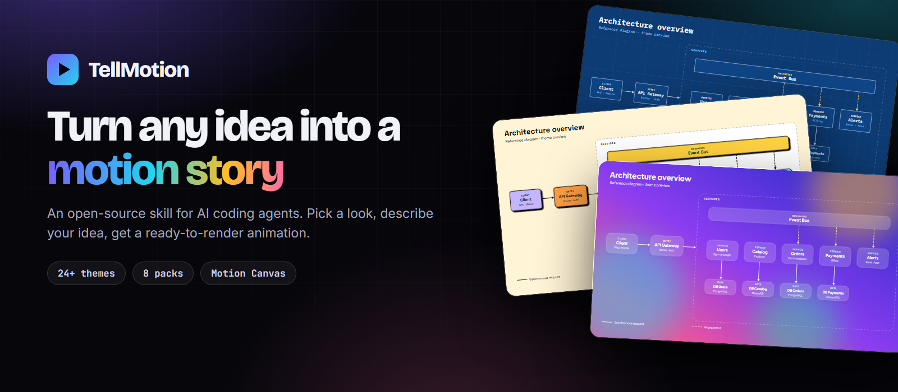
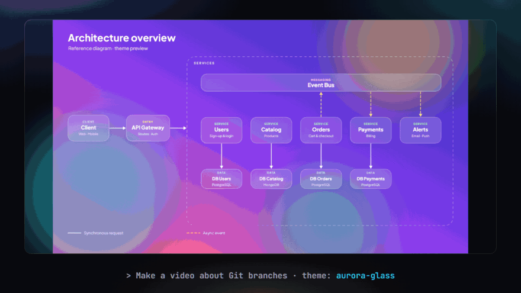
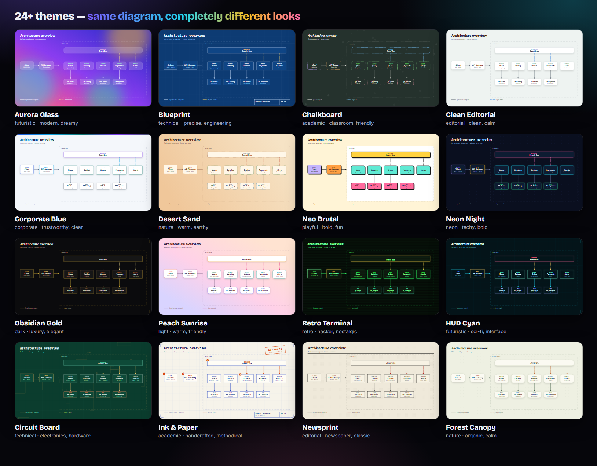

<div align="center">



<br>

**Una skill de código abierto para agentes de IA que convierte una idea en una animación explicativa 2D con acabado profesional.**<br>
Elige un estilo de un catálogo de temas en crecimiento, describe lo que quieres explicar y obtén un proyecto de [Motion Canvas](https://motioncanvas.io) listo para renderizar.

<br>

[](LICENSE)
[](LICENSE-CONTENT.md)
[](skills/tellmotion/themes)
[](skills/tellmotion/references/packs.md)
[](CONTRIBUTING.md)

[**Web**](https://yoelruso.github.io/TellMotion/) · [**Galería de temas**](https://yoelruso.github.io/TellMotion/#themes) · [**Instalar**](#-instalación-en-2-minutos) · [**Aportar un tema**](CONTRIBUTING.md) · [English](README.md)

<br>



<sub>Un diagrama, con otro estilo con solo cambiar un archivo de tema.</sub>

</div>

<br>

## ✨ Por qué TellMotion

| 🎨 **Primero el estilo, luego el código** | 🧩 **Sirve para cualquier tema** | ⚡ **Una sola conversación** |
|---|---|---|
| Elige un tema listo, pide tres propuestas a medida o trae tu marca. Las vistas previas se generan sin Figma. | Ocho packs de componentes: cloud, algoritmos, gráficas, diagramas de flujo, líneas de tiempo, código, tipografía y ciencia. | Brief, diseño, animación y revisión en un solo flujo. Tú controlas la historia y el estilo; la skill se ocupa del resto. |

## 🎬 Cómo funciona

| | Paso | Qué ocurre |
|:-:|---|---|
| **1** | **Descríbelo** | Cuéntale a tu agente qué quieres explicar. Solo pregunta lo que falta: tema, duración, ritmo. |
| **2** | **Elige un estilo** | Una plantilla del catálogo, tres propuestas a medida o los colores de tu marca. |
| **3** | **Se anima** | Se crea un proyecto de Motion Canvas con tu tema y los packs de componentes adecuados. |
| **4** | **Revisa y renderiza** | Con comprobación de tipos y revisión fotograma a fotograma. Renderiza a mp4 o ajusta cualquier texto, color o tiempo. |

## 🖼️ Temas

Cada tema es **un único archivo JSON**: colores, tipografías, formas, sombras y movimiento (ritmo, easing, entradas). El mismo archivo genera la vista previa *y* la animación, así que cambiar de estilo es un comando.

<div align="center">

</div>

Explóralos todos, con sus paletas y prompts para copiar, en la **[galería web](https://yoelruso.github.io/TellMotion/#themes)**.

## 🧰 Packs de componentes

Piezas animadas listas para usar que se adaptan a cualquier tema.

| Pack | Piezas | Ideal para |
|---|---|---|
| **algorithms** | Cell · Bar · Pointer · TreeNode · swap | ordenación, búsqueda, estructuras de datos |
| **charts** | BarChart · LineChart · PieChart · Counter | historias con datos y métricas |
| **flowchart** | Terminator · Process · Decision · DataIO | procesos y decisiones |
| **timeline** | Timeline con hitos y fases | historia, hojas de ruta |
| **code** | CodeView (sintaxis con el tema) · Terminal | tutoriales de programación, demos de CLI |
| **typography** | KineticTitle · BulletList · Quote · Compare | intros, ideas clave, A contra B |
| **science** | Cycle · Layers · Wave · Particles | procesos naturales, sistemas |
| **cloud** | Service · Queue · Lambda · Database | arquitecturas, flujos de eventos |

API completa: [`references/packs.md`](skills/tellmotion/references/packs.md).

## 🚀 Instalación en 2 minutos

**Deja que tu agente lo haga.** Envía esto a Claude Code, Cursor, Codex u OpenCode:

```text
Install TellMotion for me by reading https://raw.githubusercontent.com/YoelRuso/TellMotion/main/llms.txt
```

El agente te dice qué va a ejecutar, te pide confirmación (global o solo este proyecto), instala la skill y la verifica con `doctor`.

<details>
<summary><b>Otras formas de instalar</b></summary>

**Un comando** (requiere Node 18+):
```bash
npx -y skills@latest add YoelRuso/TellMotion --skill tellmotion --agent claude-code --global --copy --yes
```

**Manual** (funciona en todas partes):
```bash
git clone https://github.com/YoelRuso/TellMotion.git
cp -r TellMotion/skills/tellmotion ~/.claude/skills/      # global; o .claude/skills/ dentro de un proyecto
```

**Verifica** cualquier instalación:
```bash
node ~/.claude/skills/tellmotion/tools/doctor.mjs
```
</details>

Después, simplemente pide:
> Haz una animación que explique cómo funcionan las ramas de Git. Tema: blueprint.

**Requisitos:** Node 18+ y npm, y un agente de IA compatible con skills (pensada para Claude Code). Figma es opcional.

### Prueba a pedir…
- *"Visualiza quicksort paso a paso con barras animadas. Usa el tema neon-night."*
- *"Explica el ciclo del agua para niños con un estilo suave y amable."*
- *"Anima nuestro flujo de onboarding. Enséñame 3 propuestas visuales primero."*

### O usa las herramientas directamente
```bash
node skills/tellmotion/tools/list-themes.mjs                 # catálogo compacto
node skills/tellmotion/tools/validate.mjs                    # valida todos los temas
node skills/tellmotion/tools/doctor.mjs                      # comprueba que la skill está completa
node skills/tellmotion/tools/build-catalog.mjs out           # vistas previas SVG + galería
bash skills/tellmotion/scripts/new-project.sh mi-video --theme blueprint --pack algorithms,charts --demos
```

## 🗺️ Qué hay dentro

```
skills/tellmotion/   la skill: SKILL.md, themes/, tools/, assets/ (plantilla + packs), references/
site/                la web (Astro), generada a partir de los temas
test/ · scripts/     tests y scripts de mantenimiento
llms.txt             instrucciones de instalación legibles por agentes
AGENTS.md            guía para agentes que trabajen en este repo
docs/assets/         imágenes del README
```

## 🛣️ Hoja de ruta (lista completa en [ROADMAP.md](ROADMAP.md))

- [x] Formato de tema, generador de vistas previas (sin Figma) y `apply-theme`
- [x] 24 temas, 8 packs de componentes, plantilla genérica de Motion Canvas
- [x] Web con demo en vivo y galería con búsqueda
- [ ] Seguir ampliando el catálogo (temas de la comunidad bienvenidos)
- [ ] Vídeos de ejemplo en distintos ámbitos (software, ciencia, algoritmos)
- [ ] Empaquetado como plugin instalable

## 🤝 Contribuir

Ejecuta `npm test` antes de abrir un PR. Los temas son la forma más fácil de empezar: copia uno, cambia los tokens, pasa el validador y abre un PR. Consulta [CONTRIBUTING.md](CONTRIBUTING.md), [AGENTS.md](AGENTS.md) y el [formato de tema](skills/tellmotion/references/theme-format.md).

## 📄 Licencia

Código: [MIT](LICENSE). Temas, contenido de la web y ejemplos: [CC BY 4.0](LICENSE-CONTENT.md). Las tipografías de terceros mantienen sus licencias abiertas (SIL OFL / Apache 2.0).

<div align="center"><sub>Si TellMotion te ahorra tiempo, una ⭐ ayuda a que otros lo encuentren.</sub></div>
